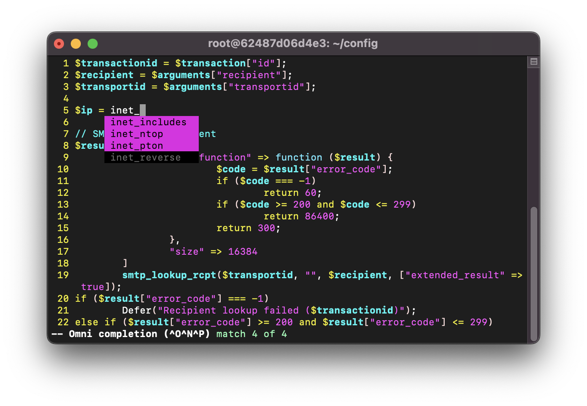
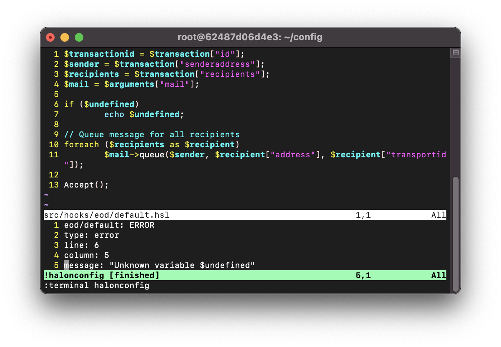

# HSL plugin for Vim and Neovim

This plugin adds [HSL](https://docs.halon.io/hsl/) (Halon Scripting Language) support to [Vim](https://www.vim.org) and [Neovim](https://neovim.io).

## Features

* Syntax highlighting
* Indentation
* Completion
  * Covers the entire standard library
  * Trigger with `Ctrl-X Ctrl-O` (omni completion)

## Installation

### Vim

To install the plugin use the following command.

```bash
git clone https://github.com/halon/vim-hsl.git ~/.vim/pack/vendor/start/vim-hsl
```

To enable it add the following to your `~/.vimrc` file.

```vim
syntax on
filetype plugin indent on
```

#### Plugin managers

If you use a plugin manager, add the repository to it instead of cloning it manually. With [vim-plug](https://github.com/junegunn/vim-plug), add the following between `call plug#begin()` and `call plug#end()` in your `~/.vimrc` file. vim-plug enables syntax highlighting and filetype plugins itself, so the lines above are not needed.

```vim
Plug 'halon/vim-hsl'
```

#### Upgrade

In order to upgrade the plugin, use the following command.

```bash
git -C ~/.vim/pack/vendor/start/vim-hsl pull
```

If you installed it with a plugin manager, use its update command instead (e.g. `:PlugUpdate`).

### Neovim

To install the plugin use the following command.

```bash
git clone https://github.com/halon/vim-hsl.git ~/.local/share/nvim/site/pack/vendor/start/vim-hsl
```

Neovim enables syntax highlighting and filetype plugins by default, so no extra configuration is needed.

#### Plugin managers

If you use a plugin manager, add the repository to it instead of cloning it manually. With [lazy.nvim](https://github.com/folke/lazy.nvim), add the following plugin spec.

```lua
{ "halon/vim-hsl", ft = "hsl" }
```

Neovim 0.12 and later also include an (experimental) built-in plugin manager. To use it add the following to your `init.lua` file.

```lua
vim.pack.add({ "https://github.com/halon/vim-hsl" })
```

#### Upgrade

In order to upgrade the plugin, use the following command.

```bash
git -C ~/.local/share/nvim/site/pack/vendor/start/vim-hsl pull
```

If you installed it with a plugin manager, use its update command instead (e.g. `:Lazy update` or `:lua vim.pack.update()`).

## Screenshots
<p align="center">
  
</p>
<p align="center">
  
</p>
